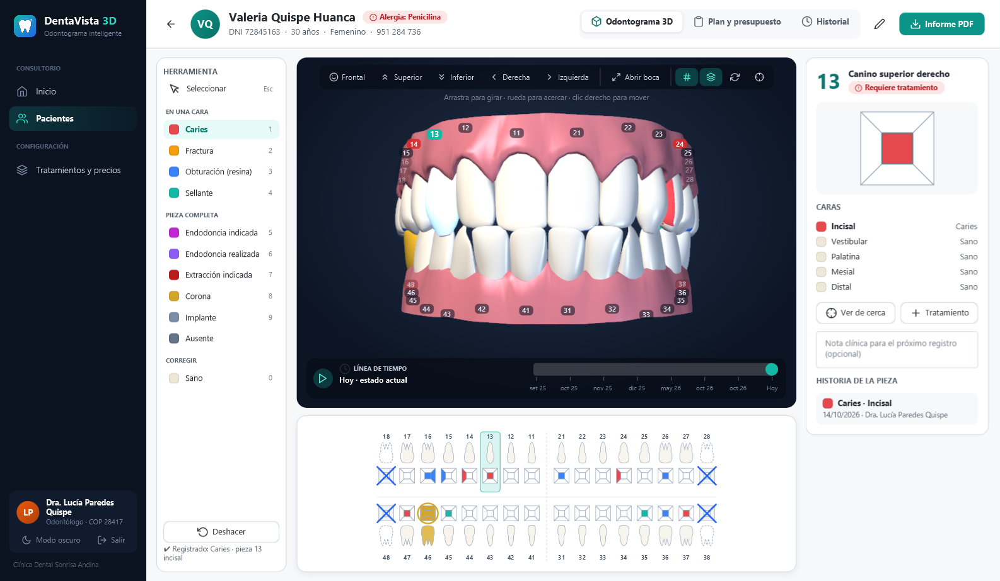
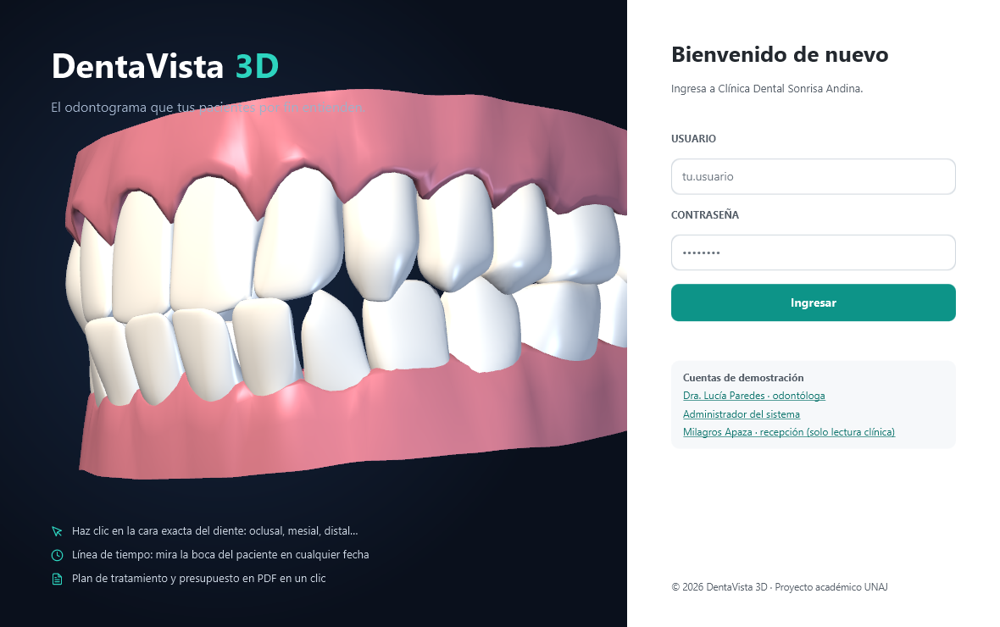
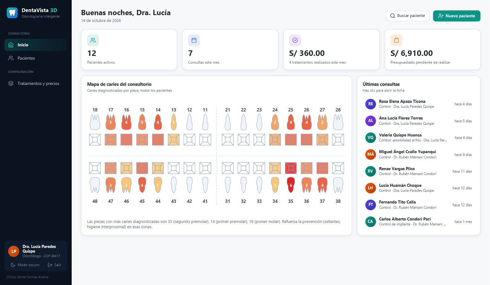
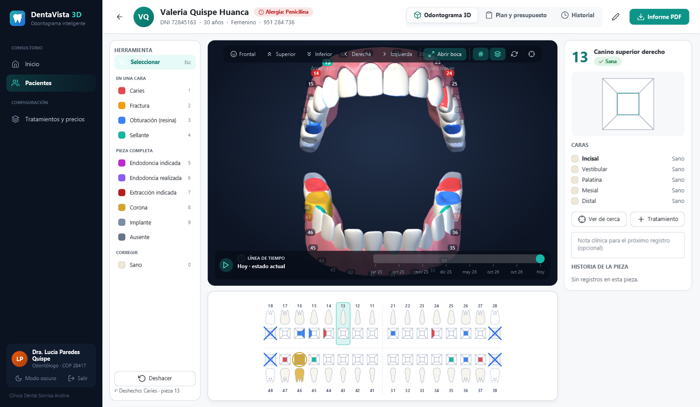
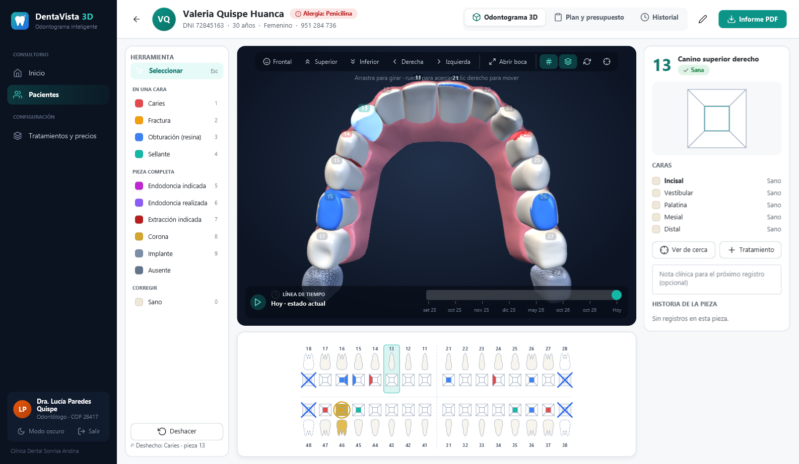
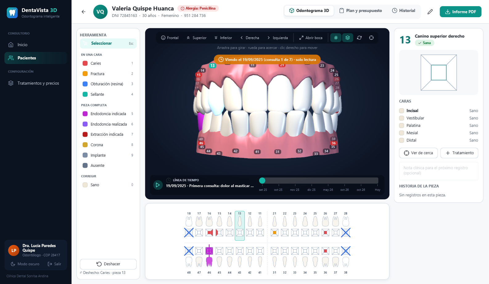
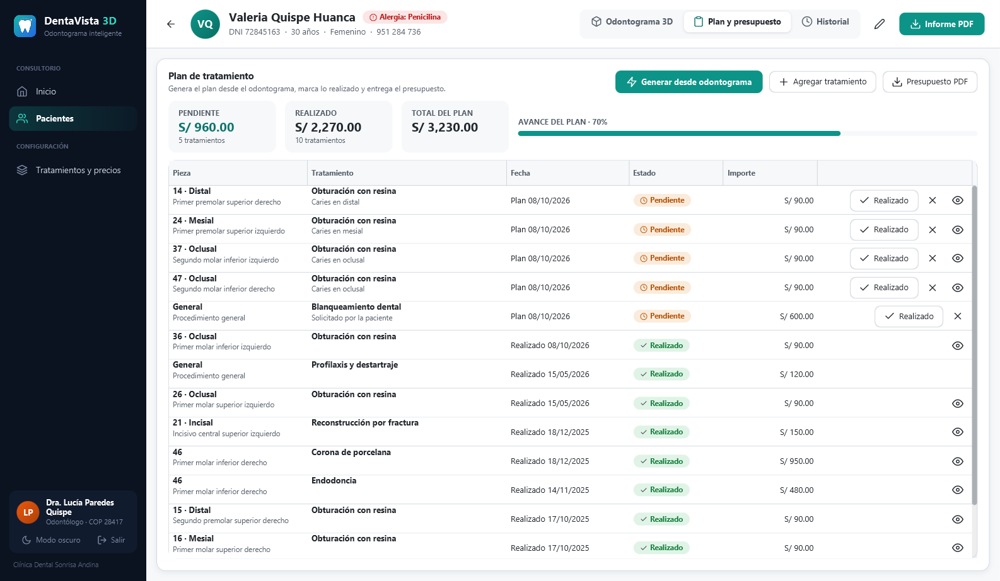
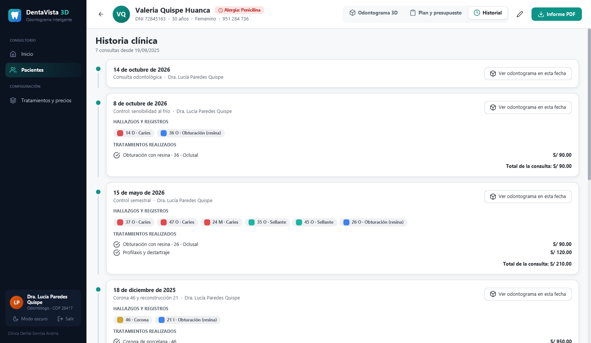
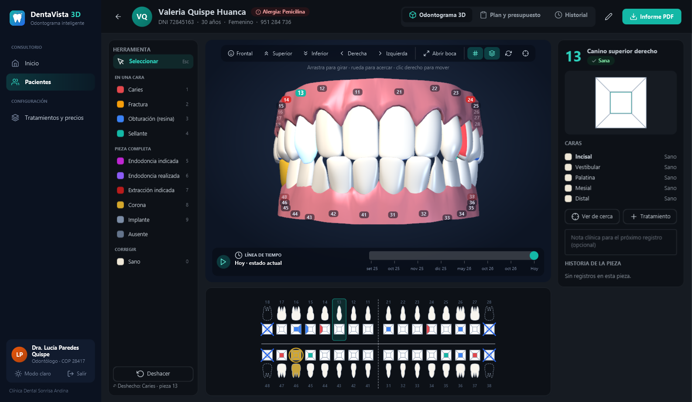
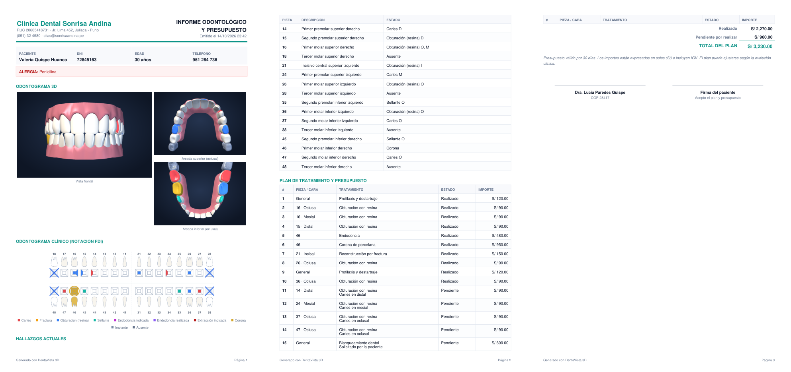

# DentaVista — Gestión clínica dental con odontograma 3D

> **Una sola idea, bien resuelta:** el odontólogo registra el estado de la boca del paciente
> haciendo clic **sobre la cara exacta de cada diente en un modelo 3D**, y el sistema
> convierte ese diagnóstico en un **plan de tratamiento con presupuesto** y en una
> **historia clínica que se puede recorrer en el tiempo**.



## El problema

En la mayoría de consultorios el odontograma se sigue llenando en papel o en planillas 2D
que el paciente no entiende: no sabe qué diente tiene caries, qué se le va a hacer ni
cuánto le va a costar. DentaVista resuelve **solo eso**, sin agenda, inventario ni
facturación:

1. **Diagnosticar**: clic en la cara del diente (oclusal, vestibular, palatina/lingual,
   mesial, distal) sobre el modelo 3D o sobre el odontograma clínico 2D.
2. **Planificar**: el plan de tratamiento y el presupuesto se generan solos a partir de las
   patologías registradas (caries → obturación, extracción indicada → exodoncia…).
3. **Tratar**: al marcar un tratamiento como realizado, el odontograma se actualiza (la
   caries pasa a obturación, la pieza extraída queda ausente).
4. **Explicar**: línea de tiempo para ver la boca en cualquier consulta pasada, modo
   "abrir boca" y giro automático para mostrárselo al paciente, e informe PDF para entregar.

## Funcionalidades

| | |
|---|---|
| **Odontograma 3D** | 32 piezas con notación FDI, cada una dividida en sus 5 caras clínicas. Girar, acercar, desplazar, vistas frontal / oclusal superior / oclusal inferior / laterales, abrir la boca, enfocar una pieza, números flotantes, encías opcionales. |
| **Odontograma 2D** | El formato clínico estándar (siluetas + diagrama de cinco caras + símbolos de ausente, corona, endodoncia, implante), sincronizado con el 3D. |
| **Hallazgos** | Caries, fractura, obturación, sellante (por cara); endodoncia indicada / realizada, extracción indicada, corona, implante, ausente (pieza completa). **Doble clic en una cara = vuelve a sana** (en la silueta, restablece la pieza). Atajos `1`–`9`, `0` = sano, `Esc`, `Ctrl+Z` para deshacer. |
| **Validación clínica** | No deja marcar caries en una pieza ausente, ni una corona en una sola cara; el asistente de recepción solo puede consultar. |
| **Línea de tiempo** | Cada consulta es un punto; el botón ▶ reproduce la evolución del paciente consulta a consulta. |
| **Plan y presupuesto** | Generación automática desde el odontograma, tratamientos manuales, realizado / cancelado, avance del plan, precios congelados al presupuestar. |
| **Informe PDF** | Datos y alertas del paciente, tres vistas 3D, odontograma clínico, hallazgos, plan con importes y firmas. |
| **Agenda** | Calendario semanal (lunes a sábado) por odontólogo, con horario de atención y pausa; clic en un espacio libre para agendar. No permite cruces de horario. Cada cita puede ligarse a un tratamiento pendiente del plan; desde la cita se atiende al paciente y se abre su ficha. |
| **Portal del paciente** | El paciente entra con su DNI, ve **su** odontograma 3D, su plan y presupuesto, y **pide citas** en los horarios libres (quedan "por confirmar" hasta que la recepción las confirma). El acceso se crea desde la ficha (botón de llave). |
| **Pagos y saldo** | Abonos en efectivo, Yape, Plin, tarjeta o transferencia. La app muestra cuánto debe el paciente por tratamientos ya realizados y cuánto lleva pagado del plan, y permite pagar por adelantado (nunca más que el total). Emite el recibo en PDF; un recibo mal hecho se anula, no se borra. |
| **Recordatorio por WhatsApp** | En cada cita, un botón abre WhatsApp con el mensaje listo: fecha, hora, odontólogo y tratamiento. |
| **Recetas** | Vademécum odontológico con la dosis habitual precargada. Cruza cada medicamento con las alergias (amoxicilina en alérgicos a la penicilina) y los antecedentes (AINE en anticoagulados o embarazadas) y exige confirmar las alertas. Emite la receta en PDF y queda en el historial de la consulta. |
| **Inicio** | Lo del día: citas de hoy, solicitudes por confirmar, pacientes con saldo pendiente y pacientes con tratamientos pendientes sin cita (para llamarlos). Indicadores de cobrado y por cobrar. |
| **Formularios rápidos** | Máscaras de entrada: la fecha se escribe solo con números (`12051996` → 12/05/1996, también `120596`), el celular se formatea solo (951 284 736), el DNI acepta 8 dígitos, montos con 2 decimales, nombres con mayúscula inicial automática y búsqueda de paciente o pieza escribiendo parte del nombre. |
| **Extras** | Pantalla de carga inmediata al abrir, modo claro / oscuro (también el menú lateral), alertas médicas (alergias, anticoagulantes, embarazo) visibles en toda la ficha, roles (administrador, odontólogo, asistente). |

## Cómo ejecutar

Requisitos: **JDK 17 o superior** (probado con JDK 21). Maven viene incluido (`mvnw`).

```bash
./mvnw javafx:run
```

En Windows: `mvnw.cmd javafx:run`. Desde IntelliJ IDEA: abrir la carpeta como proyecto
Maven y ejecutar `com.dentavista.Launcher`.

La base de datos `dentavista.db` (SQLite) se crea sola la primera vez con **12 pacientes de
demostración** con historias de hasta un año (fechas relativas a hoy, la demo nunca
envejece). Para empezar con la base vacía: `app.demo.enabled=false` en
`application.properties`.

### Usuarios de demostración

| Usuario | Contraseña | Rol | Puede |
|---|---|---|---|
| `dra.paredes` | `dentista123` | Odontóloga | Todo lo clínico |
| `dr.mamani` | `dentista123` | Odontólogo | Todo lo clínico |
| `admin` | `admin123` | Administrador | Todo + usuarios y precios |
| `recepcion` | `recepcion123` | Asistente | Agenda, pacientes y fichas (sin modificar la historia clínica) |
| `72845163` | `paciente123` | Paciente | Solo su odontograma, su presupuesto y sus citas |

Paciente recomendado para la demo: **Valeria Quispe Huanca** (6 consultas, todos los tipos
de hallazgo, alergia a la penicilina).

### Pruebas

```bash
./mvnw test
```

53 pruebas: reglas del odontograma (dominio puro), reconocimiento del modelo 3D,
servicios clínicos, de plan, agenda, pagos y recetas sobre SQLite real, seguridad y datos de demostración.

### Ejecutable de Windows

```bash
./mvnw package -DskipTests
mkdir build\staging
copy target\dentavista-1.0.0.jar build\staging\
jpackage --type app-image --name DentaVista --input build/staging --main-jar dentavista-1.0.0.jar ^
  --icon build/icono.ico --dest dist --app-version 1.0.0 --vendor "DentaVista"
```

Genera `dist/DentaVista/DentaVista.exe` (incluye su propio Java; no requiere instalar nada).

## Arquitectura

```
com.dentavista
├── dominio      Lógica pura, sin Spring ni JavaFX: Pieza (FDI), Superficie,
│                EstadoDental y Odontograma (reconstrucción desde los registros)
├── modelo       Entidades JPA: Paciente, Consulta, Hallazgo, Tratamiento, ItemPlan, Usuario
├── repositorio  Spring Data JPA
├── servicio     ClinicaService, PlanService, PacienteService, CatalogoService,
│                UsuarioService, EstadisticaService, PdfService
├── tresd        Motor del odontograma 3D: Malla (OBJ + Catmull-Clark), ModeloDental
│                (reconocimiento de piezas y caras) y VisorDental3D (componente JavaFX)
├── ui           Componentes reutilizables: Odontograma2D, Notificador, Tema, Ui
├── vista        Pantallas (login y panel en FXML; ficha, plan, historial, etc.)
└── datos        Datos de demostración
```

Stack: **Java 17 · Spring Boot 3 · JPA/Hibernate · SQLite · JavaFX 21 (3D) · AtlantaFX ·
Ikonli · OpenPDF · JUnit 5**.

### Decisiones de diseño

- **El odontograma no se guarda, se reconstruye.** Solo se guardan los hallazgos con su
  fecha (`Hallazgo`); `Odontograma.reconstruir(registros, hasta)` los aplica en orden.
  Así la línea de tiempo es gratis y nunca se pierde información clínica (patrón
  *event sourcing*).
- **Del OBJ al modelo clínico, en Java puro** (`tresd.ModeloDental`):
  1. Se separa la malla en piezas conexas → 2 encías y 28 dientes.
  2. Cada diente se compara con su vecino en planta para saber si es superior o inferior;
     el lado da el cuadrante y la distancia al frente la posición → número FDI.
  3. Los terceros molares (18, 28, 38, 48) se generan a partir del segundo molar.
  4. Dos pasos de **subdivisión Catmull-Clark** convierten el modelo facetado en dientes lisos.
  5. Cada triángulo se clasifica en una de las 5 caras según hacia dónde mira respecto a la
     arcada (oclusal, vestibular, lingual, mesial, distal). Cada cara es una malla propia,
     por eso se puede pintar una caries solo en la cara mesial de un premolar.
- **Precio congelado**: el ítem del plan copia el precio del catálogo al crearse; cambiar
  precios no altera presupuestos ya entregados.
- **Errores de negocio legibles**: cada validación devuelve un mensaje que dice qué pasó y
  qué hacer, y en los formularios aparece dentro del diálogo sin perder lo escrito.

## Capturas

| | |
|---|---|
|  |  |
|  |  |
|  |  |
|  |  |



---

Proyecto académico — Universidad Nacional de Juliaca (UNAJ), curso de programación en Java.
